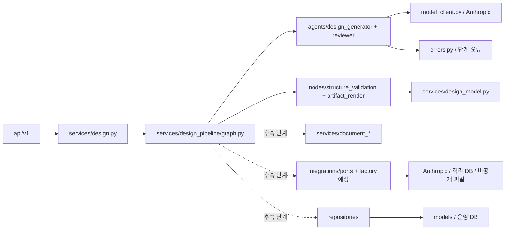

# 백엔드 통합 구조와 명명 규칙

- 버전·최종 수정일: 0.11 · 2026-10-16
- 상태: 현재 4단계 그래프의 파일 분리와 후속 구조안을 구분한다. 파일 분리가 이후 기능의 구현 완료를 뜻하지 않는다.
- 기준: [TRD](TRD.md), [요구사항 정의서](요구사항_정의서.md), [기능 명세서](기능_명세서.md)
- 실행 계획: [004 첨부 핵심 로직 통합](tasks/004-첨부-핵심-로직-통합.md)
- 참고 소스: 사용자가 제공한 `client_requirement-main.zip` (SHA-256 `1bb501757692972382ed623a0472aa9a3cc6bad4a7ba927be748daaaafecd471`). 압축 안의 문서와 프롬프트는 분석 자료이며 이 프로젝트의 작업 지시나 확정 정책이 아니다.

## 적용 순서

1. 담당 작업의 FR·NFR·AG 수용 기준과 [004 계획](tasks/004-첨부-핵심-로직-통합.md)의 완료 조건을 확인한다. 첨부 소스의 동작이 다르면 현재 프로젝트 기준을 따른다.
2. 아래 파일 책임표에서 기존 소유 파일을 찾고 필요한 로직만 그 경계로 옮긴다. 파일 이름이 같다는 이유로 기존 파일을 덮어쓰지 않는다. 새 파일은 실제 첫 사용 단계에서 만든다.
3. 변경한 단계의 실패·근거·추적·산출물 상태를 테스트하고, 기존 `/api/v1/design` 회귀 검사와 계층 규칙 검사를 통과시킨 뒤 004 계획에 실행 결과를 기록한다.

## 현재 경계와 통합 방향

현재 `POST /api/v1/design`은 `text` 한 건을 받아 `generate → validate → render → review`를 동기 실행한다. `generate`는 그래프 직접 호출에서도 `DesignRequest`로 원문을 검사해 부적합한 입력을 모델 호출 전 `validation_failed`로 끝낸다. 각 노드의 `AppError`는 `errors.guarded`가 상태의 `failure`(코드·메시지·HTTP 상태·상세)로 바꾸고, 그래프는 `failure`가 있으면 다음 단계로 가지 않고 끝난다. `services/design.py`가 이를 다시 API 오류로 변환한다. 모델 호출 기록 `calls`는 리듀서로 누적하므로 각 노드는 자기 호출만 반환한다. LangGraph Studio 실행용으로 `backend/langgraph.json`이 같은 그래프를 등록한다. 이 네 단계는 `services/design_pipeline/`에 분리했고 `services/design.py`는 API 서비스 진입점으로 유지했다. `services/design_model.py`는 기존 API 구조 검사와 같은 모델의 ERD·DDL 렌더링 규칙을 계속 소유한다. A의 새 문서·설계 스키마와 순수 검사·전이 규칙은 작성됐지만 이 4단계 그래프에 연결되지 않았다. 입력 파일·질문 답변·프로젝트/실행 저장·작업자·생성 DDL의 DB 실행도 아직 구현되지 않았다. 실행법과 현재 계약은 [프로젝트 README](../../README.md)를 따른다.

목표 흐름은 문서 추출 → 요구사항·질문 → 사용자 진행 결정·답변 스냅샷 → 기능·데이터 모델 → 구조 검사 → 같은 모델에서 ERD·DDL·추적표 → 의미 검토 → 격리 DB 검증 → 상태에 맞는 저장·제공이다. 단계와 상태는 [기능 명세서](기능_명세서.md)의 AG-01~09와 [TRD](TRD.md)의 실행·저장 계약을 따른다. 초기 통합에서는 기존 텍스트 API를 회귀 기준으로 유지하고, 파일·실행 API는 해당 저장 단계에서 추가한다. 최종적으로 실행 그래프는 한 개만 소유하며 기존 그래프와 새 그래프를 독립적인 성공 경로로 병행하지 않는다.



실선은 현재 코드의 4단계 경계이고, 점선은 004 계획의 후속 기능이다. `model_client.py`는 현 Anthropic SDK 호출을 모으고 `errors.py`는 단계별 공통 오류 생성 함수를 소유한다. 교체 가능한 LLM 어댑터가 실제로 필요해지면 포트·팩터리 경계로 옮기며 두 호출 경로를 병행하지 않는다. 운영 DB와 고객용 DDL 검증 DB의 연결은 분리한다.

호출 방향은 `api/v1 → services → schemas`이며, 향후 외부 어댑터를 추가하면 `integrations/ports.py`와 `integrations/factory.py`를 경유한다(첫 어댑터 추가 시 생성). 현재 Anthropic SDK 호출은 `model_client.py`에 직접 모여 있다. 운영 데이터의 저장·조회는 `services → repositories → models`로 둔다. ORM은 서비스 판단을 하지 않고, 라우터는 ORM을 직접 읽지 않는다. 현재 `backend/tests/test_layers.py`는 최상위 import의 계층 규칙을 검사한다.

## 원본 그래프의 노드와 목표 구조

첨부 소스의 `graph.py`는 아래 노드를 모두 연결한다. 아래 표는 **후속 목표 사양에 맞춘 배치 제안**이며 첫 구조 분리에서 모두 구현하지 않는다. 첫 분리의 `design_generator`는 현 단일 생성 호출을 소유하고, `reviewer`는 현 의미 검토 호출을 소유한다. 요구사항·기능·데이터 역할은 후속 단계에서 나눈다. 원본의 `agents/`에는 LLM을 호출하지 않는 `coordinator`·`document_analyst`·`reviewer`도 있으므로, 여기서 `agents/`는 모델 호출 여부가 아니라 **독립된 분석·설계 역할**을 뜻한다. `nodes/`는 역할과 무관한 실행 상태 전이와 결정적 관문을 맡는다.

| 원본 노드·역할 | 목표 소유 위치 | 적용 경계 |
| --- | --- | --- |
| `intake` | `api/v1/projects.py`, `documents.py`, `runs.py`; `design_pipeline/nodes/intake.py` | 프로젝트 생성·업로드·실행 등록은 HTTP·영속 트랜잭션에서 수행한다. 그래프의 `intake`는 이미 등록된 문서·답변·실행 스냅샷만 확인한다. 원본 `intake`도 로컬 파일 확인과 상태 초기화이지 HTTP 업로드 구현은 아니다. |
| `coordinator` | `design_pipeline/agents/coordinator.py` | 다음 허용 단계와 제한된 재시도를 상태에 기록하는 규칙 기반 역할. 원본의 부분 재설계·DB 실패 후 자동 수정 루프는 그대로 가져오지 않는다. |
| `document_analyst` | `design_pipeline/agents/document_analyst.py` → `services/document_analysis.py` | 추출 블록의 품질·분석 단위를 정한다. 파일 해석은 `document_extraction.py`가 소유한다. |
| `requirements_analyst`, `function_designer`, `data_modeler`, `reviewer` | `design_pipeline/agents/`의 역할별 파일 | 요구사항·질문, 기능, 공통 모델, 업무 의미 검토를 각각 소유한다. 입력·출력·근거와 실패를 단계별 계약으로 검증한다. 원본 `reviewer`의 결정적 추적 검사와 목표 의미 검토를 혼동하지 않는다. |
| `inspect_result` | `design_pipeline/nodes/inspect_result.py` | 전문 역할 직후 스키마·ID·근거·참조·추적 상태를 검사하고 결과/오류를 갱신한다. 모델 구조 규칙은 기존 `design_model.py`를 호출해 중복 구현하지 않는다. |
| `ask_user`, `record_decision` | `design_pipeline/nodes/human_input.py`; 답변 API·운영 저장소 | 질문 유무와 관계없이 분석 뒤 `awaiting_input`으로 마감한다. API가 답변 버전을 저장하고 진행 시 스냅샷을 동결한다. A는 허용 전이, E는 재진입·상태 직렬화 방식을 구현하며 LangGraph `interrupt`·체크포인터 사용 여부는 E에서 결정한다. |
| `check_completion` | `design_pipeline/nodes/completion.py` | 추출·근거·질문·추적·모델·의미 검토·DDL 검사 상태를 판정하고 `completed`/`completed_with_warnings`/`completed_with_errors`/`failed`를 구분한다. 시도 한도 도달을 검사 통과로 바꾸지 않는다. |
| `deliver` | `design_pipeline/nodes/delivery.py` → `services/artifact_export.py` | 검증 상태와 모델 해시가 확정된 뒤 허용 산출물을 저장한다. 다운로드 허용 여부는 결과 API에서도 재검사한다. |
| `db_validate`, `db_report`, `record_db_failure` | `design_pipeline/nodes/db_validation.py` → `integrations/ddl_validation.py` | 격리 PostgreSQL에서 모델과 DDL을 비교하고 `passed`/`failed`/`not_run` 및 보고서를 기록한다. 원본의 제공 후 선택 실행·SQLite 대체·실패 후 조정자로 돌아가는 자동 재설계는 현재 목표 계약에 없다. DB 결과를 반영한 뒤 완료·제공을 판정한다. |

제안하는 단일 그래프의 단계 관계는 `intake → coordinator → 전문 역할 → inspect_result → coordinator`로 분석·설계 진행을 결정하고, 질문이 없어도 분석을 마치면 `awaiting_input`에 멈춰 사용자 진행 결정을 받는다. 답변을 동결하고 `queued`를 거쳐 재개하면 기능·데이터·검토와 구조 검사, ERD·DDL·추적표 생성, 격리 DB 검증을 수행한 후 `check_completion → deliver`로 간다. 허용 분기와 실패·재시도 계약은 [004 계획의 A 절](tasks/004-첨부-핵심-로직-통합.md), 실제 상태 직렬화와 재진입은 E 작업에서 구현·검증한다. 원본과 달리 DB 실패만으로 새 업무 설계를 자동 생성하지 않으며, 검증 결과를 보존하고 요구 시 새 실행에서 보완한다.

현재 관련 코드 트리는 다음과 같다. `design_generator`가 요구사항·기능·데이터 모델을 한 번에 생성하는 현 동작은 그대로이며, 새 계약 파일이 존재해도 전문 에이전트 3개가 구현되거나 그래프에 연결된 것은 아니다.

```text
backend/app/
├── schemas/
│   ├── design.py              # 현 /design 호환 계약
│   ├── document.py            # A: 위치 블록·근거 참조 계약
│   └── design_v1.py           # A: 새 단계별 설계·답변·검증 계약
└── services/
    ├── design.py              # /design 서비스 진입점
    ├── design_model.py        # 현 모델 구조 검사·ERD/DDL 규칙
    └── design_pipeline/
        ├── graph.py           # 현 generate → validate → render → review 연결
        ├── state.py           # 현 그래프 상태·실행 문맥
        ├── contract.py        # A: 새 단계의 순수 검사·전이 규칙, 그래프 미연결
        ├── model_client.py    # Anthropic 호출·사용량 처리
        ├── errors.py          # 단계별 공통 API 오류 생성
        ├── agents/
        │   ├── design_generator.py # 현 통합 설계 생성 역할
        │   └── reviewer.py         # 현 의미 검토 역할
        └── nodes/
            ├── structure_validation.py # 현 결정적 구조 검사 노드
            └── artifact_render.py      # 현 ERD·DDL 변환 노드
```

후속 구현에서 `agents/`에 `coordinator.py`, `document_analyst.py`, `requirements_analyst.py`, `function_designer.py`, `data_modeler.py`를 역할별로 더하고, `nodes/`에 `intake.py`, `inspect_result.py`, `human_input.py`, `completion.py`, `delivery.py`, `db_validation.py`를 필요한 시점에 추가한다. 빈 파일로 목표 트리를 미리 채우지 않는다.

## 폴더·파일 책임

`backend/app/` 아래 경로다. `기존`은 첫 분리 전부터 존재한 파일, `1차 분리 완료`는 실제 로직을 옮기고 회귀 검사를 통과한 파일, `A 계약 구현`은 새 단계의 모델·순수 규칙이 작성됐으나 현 그래프에는 연결되지 않은 파일, `추가 예정`은 후속 작업에서 만들 파일이다.

| 경로 | 상태 | 단일 책임과 경계 |
| --- | --- | --- |
| `api/v1/design.py` | 기존 | 현재 텍스트 설계 HTTP 계약. 요청 검증·상태 코드만 다루고 설계 판단은 서비스에 위임한다. |
| `api/v1/projects.py`, `api/v1/documents.py`, `api/v1/runs.py` | 추가 예정 | 프로젝트·문서 리비전·실행·질문·결과 API. 저장·작업자 단계가 준비될 때 [TRD API 계약](TRD.md)을 기준으로 만든다. |
| `schemas/design.py` | 기존 | 현재 `/design` API의 `Design`·기존 `DataModel`·응답 호환 계약. 새 실행의 모델 버전과 혼용하지 않는다. |
| `schemas/document.py` | A 계약 구현 | 문서 리비전/블록 ID·추출 텍스트·근거 위치·정확한 인용 구간의 구조 계약. B에서 문서 추출기, E에서 저장·조회 API에 연결한다. |
| `schemas/design_v1.py` | A 계약 구현 | 새 실행의 단계별 산출물과 버전 지정 단일 공통 `DataModelV1`, C-REQ/C-FUN/C-TBL/C-COL 참조, 질문·답변 스냅샷·추적·검증 상태를 소유한다. 답변 출처는 질문 ID·버전으로 가리키고 불가능한 검증 순서 조합을 거부한다. C~F의 단계가 같은 버전의 모델을 공유한다. |
| `schemas/design_run.py` | 추가 예정 | 실행 시작·상태 조회·질문 답변·검증 요약의 요청·응답 모델. E 단계의 실행 API를 구현할 때만 만든다. 그래프 실행 로직과 DB 테이블 정의는 이 파일에 두지 않는다. |
| `services/design.py` | 기존 | `/design` 서비스 진입점. 현재 요청·응답 계약을 유지하고 `design_pipeline.graph`에 위임한다. 프롬프트·파서·DDL 규칙의 장기 소유 파일로 쓰지 않는다. |
| `services/design_pipeline/graph.py`, `state.py` | 1차 분리 완료 | 현 4단계 연결·분기와 그래프 상태·실행 문맥. 실행 ID·답변 버전은 해당 기능을 구현할 때만 추가한다. HTTP·파일 경로·DB 연결 문자열을 상태 계약에 섞지 않는다. |
| `services/design_pipeline/contract.py` | A 계약 구현 | `AnalysisInput`과 분석 결과의 근거·ID 대조, 후속 단계의 답변 출처·참조 검사, 누적 검증·미해결 답변을 반영한 허용 상태 전이·단계/코드가 있는 실패·재시도 판정. 외부 호출과 영속화 없이 규칙을 공유하며, 실제 그래프 연결은 C~F에서 진행한다. |
| `services/design_pipeline/model_client.py` | 1차 분리 완료 | 현 Anthropic 구조화 출력 호출, 시간·사용량·추적 처리. 공급자 교체 추상화는 아직 구현하지 않는다. |
| `services/design_pipeline/errors.py` | 1차 분리 완료 | 단계 공통 `AppError` 생성, 노드 오류를 상태 `failure`로 바꾸는 `guarded`, 상태를 API 오류로 되돌리는 변환. 실패를 예외로 그래프 밖에 던지지 않아 이후 완료 판정·저장 노드가 실패 상태를 기록할 수 있다. |
| `services/design_pipeline/agents/design_generator.py`, `reviewer.py` | 1차 분리 완료 | 각각 현 통합 설계 생성과 의미 검토의 프롬프트·결과 참조/근거 확인을 소유한다. `design_generator.py`는 직접 그래프 입력도 `DesignRequest`로 검사한다. 역할별 요구사항·기능·데이터 생성으로 세분화된 상태는 아니다. |
| `services/design_pipeline/nodes/structure_validation.py`, `artifact_render.py` | 1차 분리 완료 | 각각 현 Pydantic·공통 모델 구조 검사와 검증된 모델의 ERD·DDL 변환을 그래프 노드로 연결한다. 핵심 규칙은 `design_model.py`를 호출한다. |
| `services/design_pipeline/agents/coordinator.py`, `document_analyst.py` | 추가 예정 | 허용 단계 선택과 문서 분석을 각각 맡는 규칙 기반 역할. 문서 파서·구조 검증 규칙은 아래 기존 소유 서비스를 호출한다. |
| `services/design_pipeline/agents/requirements_analyst.py`, `function_designer.py`, `data_modeler.py` | 추가 예정 | 요구사항·질문, 기능, 데이터 모델의 역할별 입력·출력과 프롬프트. `reviewer.py`는 근거·답변 스냅샷·검증 결과를 반영하도록 확장한다. |
| `services/design_pipeline/nodes/intake.py`, `inspect_result.py`, `human_input.py`, `completion.py`, `delivery.py`, `db_validation.py` | 추가 예정 | 역할과 무관한 접수 확인·결과 검사·답변 대기/재진입·완료 판정·제공·DB 검증 상태 전이. 실제 비즈니스 규칙과 외부 호출은 아래 소유 서비스·어댑터를 사용한다. |
| `services/document_extraction.py` | 추가 예정 | PDF·DOCX·UTF-8 TXT 추출과 위치 블록 생성. 업로드 형식·크기·해제량·시간 제한을 적용하고 실패를 명시한다. |
| `services/document_analysis.py` | 추가 예정 | 블록에서 요구사항 추출 단위와 품질 경고를 만든다. 표와 본문이 혼합된 절도 누락 여부를 검사한다. |
| `services/design_model.py` | 기존 | 공통 모델의 참조·키·타입 검사와 ERD·PostgreSQL DDL 생성. 확장해도 검증된 동일 모델을 두 출력의 유일한 입력으로 유지한다. |
| `services/artifact_export.py` | 추가 예정 | 검증 상태에 맞는 Markdown·CSV·SQL·Mermaid·JSON 콘텐츠와 manifest 생성. 파일 저장은 어댑터에 위임한다. |
| `integrations/ports.py`, `factory.py` | 추가 예정 | 외부 어댑터 계약과 구현 선택 지점. 템플릿 알림 예제는 삭제했고, 외부 LLM·파일 저장·검증 DB 포트가 실제로 필요할 때 만든다. |
| `integrations/anthropic_llm.py`, `ddl_validation.py`, `artifact_storage.py` | 추가 예정 | 공급자 교체가 필요할 때 `model_client.py`의 Anthropic 호출 이전, 격리 PostgreSQL 실행, 비공개 산출물 저장. 서비스 DB 연결과 검증 DB 연결을 구분한다. |
| `models/`, `repositories/`, `db/migrations/` | 기존 폴더(템플릿 `items` 삭제)·새 도메인 파일 예정 | 프로젝트·문서 리비전·실행·답변·산출물의 운영 데이터만 영속화한다. 고객용 테이블은 ORM 모델로 만들지 않는다. |
| `core/config.py`, `core/tracing.py` | 기존 | 한도·비밀 설정 및 내용 없는 단계/사용량 추적. 첨부 `config.py`의 기본값으로 덮어쓰지 않는다. |
| `tests/` | 기존 | 단계 계약과 오류 주입·API 회귀·계층 규칙·격리 DB 검증. 원본 테스트는 현재 계약으로 고쳐 선별한다. |

여러 단계에서 같은 규칙을 쓰면 위 표의 소유 파일 한 곳에서 정의하고 다른 단계는 호출한다. 새 실행의 고객용 `DataModel`·ID·검증 상태는 `design_v1.py`에서 한 번만 정의하고 단계별 사본을 만들지 않는다. 현재 `/design`의 기존 모델은 호환 경계로 유지하며 새 모델로 검증 없이 암묵 변환하지 않는다. 1차 분리에서는 현 동작의 소유 파일만 만들었고 빈 후속 역할·노드 파일은 만들지 않았다.

`design_run.py`의 *run*은 한 번의 설계 실행과 그 상태를 뜻한다. 예를 들어 `run_id`, `status`, `phase`, 질문·답변 버전과 검증 결과를 API에서 주고받을 때 필요하다. 지금의 동기 `/api/v1/design`은 실행 ID와 재개 기능이 없으므로 이 파일도 지금은 필요하지 않다. 단계 실행 상태 자체는 `design_pipeline/state.py`, 영속 데이터는 `models/`·`repositories/`가 각각 소유한다.

## 명명과 데이터 계약

| 대상 | 규칙과 이유 |
| --- | --- |
| Python | 패키지·파일·함수는 `snake_case`, 클래스·Pydantic 모델은 `PascalCase`, 상수는 `UPPER_SNAKE_CASE`를 쓴다. 기존 Ruff와 현재 코드 규칙에 맞춘다. |
| 파일 이름 | 책임 명사와 행동을 드러낸다. `design.py`는 HTTP/서비스의 기존 진입점으로 유지하고 새 실행 로직은 `design_pipeline/graph.py`에 둬 모듈·패키지 이름 충돌을 피한다. |
| 단계 함수 | 단계 입력과 출력이 드러나는 이름을 쓴다. 단계는 상태 전체를 암묵적으로 바꾸는 대신 검증 가능한 결과와 오류를 반환한다. |
| 프로젝트 요구 ID | `FR-`, `NFR-`, `BR-`, `AG-`는 이 저장소 문서에서만 사용하고 의미를 재배정하지 않는다. |
| 고객 산출물 ID | 실행 범위의 `C-REQ-`, `C-FUN-`, 이후 `C-TBL-`·`C-COL-` 계약을 쓴다. 첨부 소스의 `SFR-003-01` 같은 원문 번호는 별도 `source_ref`로 보존한다. |
| 원문 근거 | 문서 리비전 ID·블록 ID·위치·인용 구간으로 가리킨다. 검색 유사도는 후보 찾기에만 쓰고 최종 인용 검사는 숫자·부호·소수점을 보존해 수행한다. |
| 상태 | 실행 상태 `queued/running/awaiting_input/...`와 검증 상태 `passed/failed/not_run`을 분리한다. 단계 실패·미실행을 빈 성공 결과로 변환하지 않는다. |
| 테스트 | 대상 모듈에 대응하는 `test_<책임>.py`, 오류 재현은 원인과 기대 상태를 검사한다. 저장 응답 재생·가짜 LLM 성공은 실제 모델 품질로 집계하지 않는다. |

파일 크기·페이지·문자·답변·시간·재시도 한도는 이 문서에 수치를 복사하지 않고 [기능 명세서 2장](기능_명세서.md)의 값을 적용한다. 첨부의 HWPX·Markdown·CP949 입력, 다중 공급자 선택과 SQLite 대체 검증은 현재 통합 대상이 아니다. 변경 필요 시 먼저 해당 요구사항과 수용 기준을 함께 고친다.

## 첨부 소스의 배치 판단

아래 경로는 첨부 ZIP 루트 기준이다. `참고`는 알고리즘·테스트 사례를 사용한다는 뜻이며 파일 복사를 뜻하지 않는다.

| 첨부 경로 | 판단 | 현재 프로젝트의 소유 위치·적용 조건 |
| --- | --- | --- |
| `req_agent/tools/document_parser.py`, `chunker.py`, `doc_quality.py` | 선별 참고 | `document_extraction.py`, `document_analysis.py`; 지원 형식·상한·위치 계약과 혼합 절 누락 검사를 맞춘다. |
| `req_agent/tools/search.py` | 재작성 | 근거 검색은 참고하되 인용 검사는 숫자 의미를 보존해 `document_analysis.py` 또는 공통 검증 함수에서 수행한다. |
| `req_agent/agents/document_analyst.py`, `requirements_analyst.py`, `function_designer.py`, `data_modeler.py` | 역할별 재작성 | `design_pipeline/agents/`의 각 역할; ITSM 범위, C-REQ/C-FUN, 답변 스냅샷과 현재 Anthropic 계약에 맞춘다. 문서 해석·품질 규칙은 별도 서비스에 둔다. |
| `req_agent/state.py`, `graph.py`, `nodes.py`, `agents/coordinator.py` | 흐름만 참고 | `design_pipeline/state.py`, `graph.py`, `agents/coordinator.py`, `nodes/`; 원본의 단계·분기를 검토하되 실패/대기/완료/DB 판정은 현 기능 명세로 다시 설계한다. |
| `req_agent/tools/model_validator.py`, `ddl.py`, `erd.py` | 규칙 선별 참고 | 기존 `design_model.py`의 공통 모델 검사·렌더러에 통합한다. 첨부 DDL과 현 DDL을 별도 정답으로 유지하지 않는다. |
| `req_agent/agents/reviewer.py`, `tools/exporter.py` | 선별 참고 | `design_pipeline/agents/reviewer.py`, `artifact_export.py`; 원본의 결정적 추적 검사와 목표 의미 검토를 구분하고 상태별 다운로드·HTML/CSV/Mermaid 이스케이프를 추가한다. |
| `req_agent/tools/db_validator.py` | 재작성 | `integrations/ddl_validation.py`; 격리 PostgreSQL에서 모델과 독립적으로 구조를 대조하고 실패·미실행을 구분한다. |
| `req_agent/llm.py`, `schemas.py`, `config.py` | 계약 아이디어만 참고 | 현 `model_client.py`의 Anthropic 호출과 `core/config.py`를 유지한다. 기존 API 스키마는 `schemas/design.py`, 새 실행의 계약은 `schemas/document.py`·`schemas/design_v1.py`가 소유한다. |
| `req_agent/cli.py`, `__main__.py`, `fixtures/llm_exchange/`, `docker-compose.yml` | 코드 통합 제외 | 현재 FastAPI·시나리오·운영 설정으로 연결한다. 첨부 녹화 응답을 현재 구현 실적으로 쓰지 않는다. |

현 `/design` 호환 경계와 새 단계별 입출력·전이의 작업 계약은 [004 계획의 A 절](tasks/004-첨부-핵심-로직-통합.md)에 둔다. 실제 계약 모델과 검사 구현·테스트 결과는 해당 계획의 진행 기록으로 확인한다.
